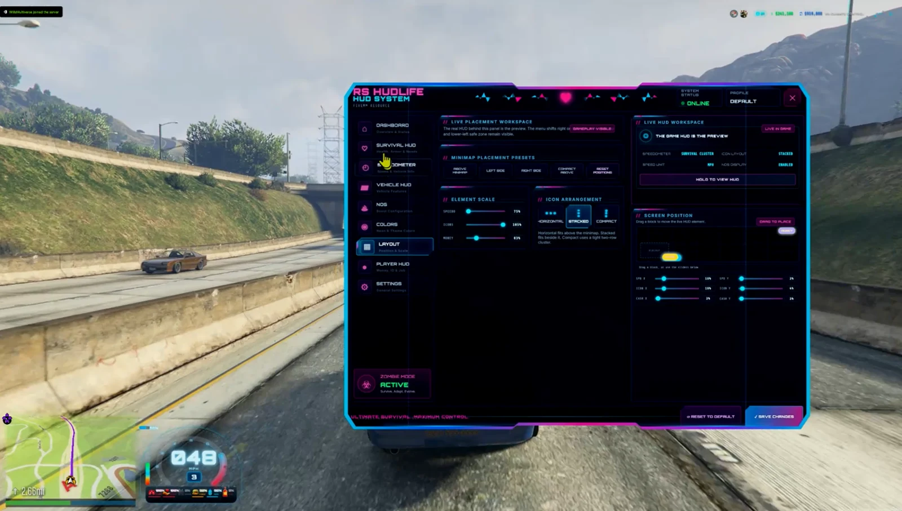
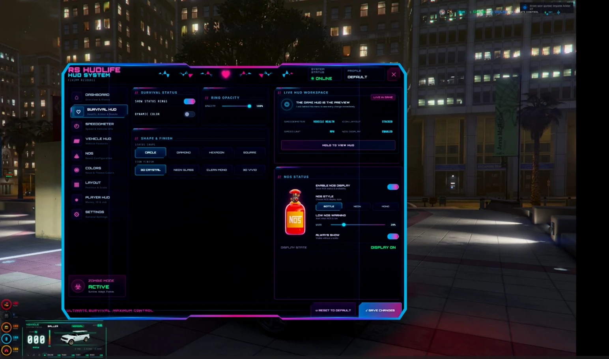
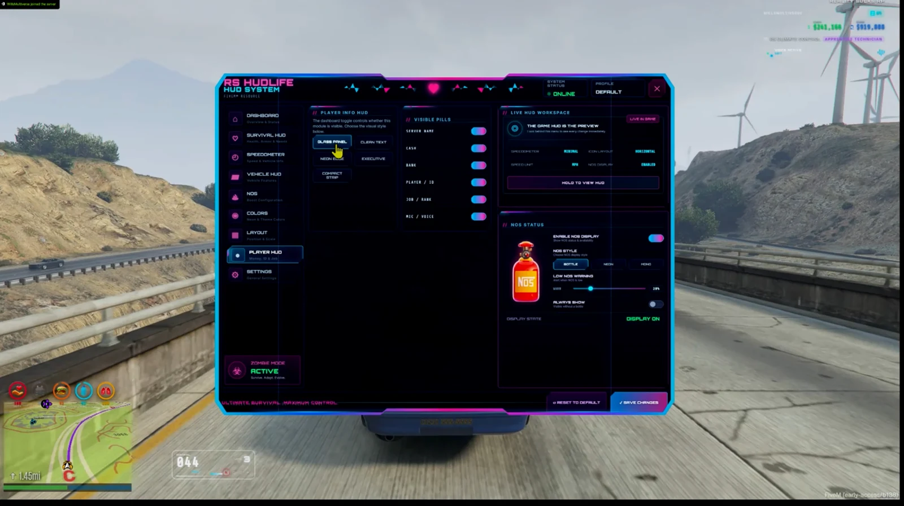
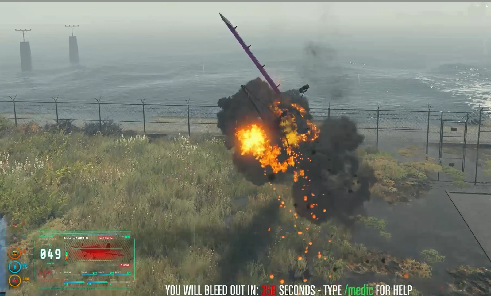

# RS HUDLife — Animated HUD

Make getting into a vehicle part of the experience. HUDLife combines 921 vehicle artwork images, 10 speedometer styles, cinematic startup animations and custom sounds with player status, money and NOS displays. Players can personalize the HUD through saved F9 settings.

[Download the original ZIP](https://github.com/RealitySucksRP/rs-lilhudlife/releases/latest/download/rs-lilhudlife.zip) | [Free on Tebex](https://reality-sucks-rp-webstore.tebex.io/package/7738377) | [Watch preview](https://youtu.be/Qo-D0QyAktE?si=4PsVCghqGk1oWjxU) | [Website](https://realitysucksrp.github.io/) | [Discord](https://discord.gg/e9V3rPHySx) | [YouTube](https://www.youtube.com/@RealitySucksRP) | [All free scripts](https://reality-sucks-rp-webstore.tebex.io/category/free-scripts)

**Install folder:** `rs-lilhudlife`. Download the original ZIP to retain the package folder layout. Source, configuration, licenses and included assets are provided below.

More screenshots

## Installation

1. Extract the original ZIP into your server resources directory.
2. Keep the resource folder named `rs-lilhudlife`.
3. Review `config.lua` and your framework/provider settings.
4. Add `ensure rs-lilhudlife` after the dependencies in `server.cfg`.
5. Restart the resource and check the UI in FiveM.

For HUDLife, F9 opens the player settings. The package includes the vehicle artwork library, 10 speedometer styles, audio, player HUD and NOS presentation.
